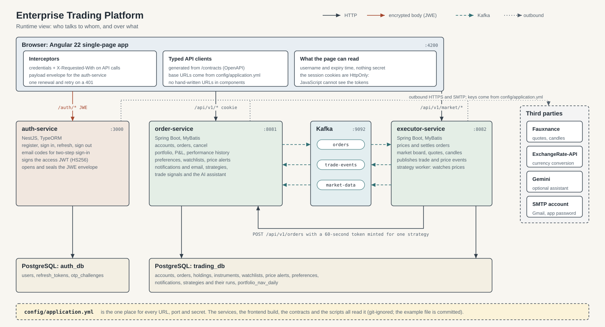
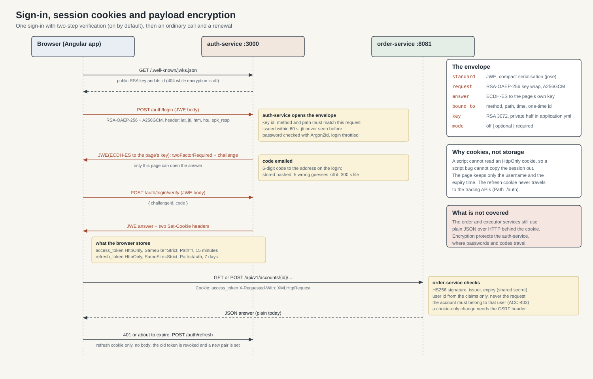
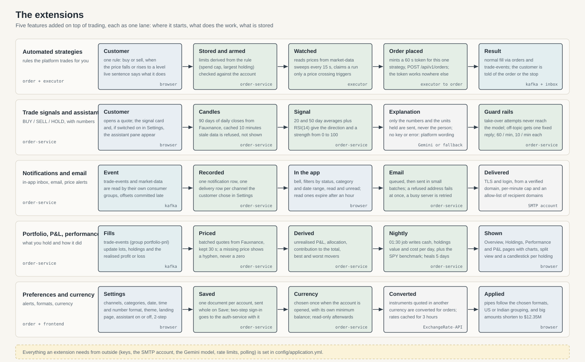

# Architecture

How the platform fits together: the parts, how a request travels, how a sign-in becomes a session, what the encryption does and does not
cover, and how each extension (strategies, signals, notifications, portfolio, preferences) runs on top of trading.

The three pictures are SVG files in [`architecture/`](architecture); they are generated from small scripts, so they stay sharp at any size.

## 1. The parts

| Part | Technology | Port | Owns |
|---|---|---|---|
| Frontend | Angular 22, signals, generated typed API clients | 4200 | Everything the customer sees. Holds no secrets: the session lives in HttpOnly cookies |
| auth-service | NestJS, TypeORM | 3000 | Registration, sign-in, two-step codes, sessions, the JWT, the payload envelope. Database `auth_db` |
| order-service | Spring Boot, MyBatis | 8081 | Accounts, orders, portfolio and P&L, preferences, watchlists and alerts, notifications and email, strategies, trade signals, the AI assistant. Database `trading_db` |
| executor-service | Spring Boot, MyBatis | 8082 | Prices and settles orders, the live market board, quote and candle endpoints, publishes events, runs the strategy worker. Shares `trading_db` |
| Kafka | Confluent image, started by you | 9092 | Three topics: `orders`, `trade-events`, `market-data` |
| PostgreSQL | 16 | 5432 | `auth_db` and `trading_db` |
| Third parties | Fauxnance, ExchangeRate-API, Gemini, an SMTP account | | Market data, currency rates, the optional assistant, email. Only the services call them; the browser never does |

Two rules shape everything else:

- **Orders are asynchronous.** The order-service stores a `NEW` order and publishes it; the executor prices it against a live quote, settles cash
  and holdings in one transaction, and the order becomes `FILLED` or `REJECTED`. The result comes back as an event.
- **One configuration file.** Every URL, port and secret is in `config/application.yml` ([how it is read](../../config/README.md)). No service holds a
  setting of its own.

### How the browser reaches the services

The dev server proxies `/api` (market data included, which the order-service relays from the executor) to the order-service, so it sees same-origin calls and needs no
CORS. The auth-service is called directly (its CORS allows the frontend origin from `application.yml`, with credentials). The proxy, the base URLs
and the contracts' `servers:` are generated from the same file.

## 2. Kafka

| Topic | Written by | Read by (consumer group) | What |
|---|---|---|---|
| `orders` | order-service, after the order's transaction commits | executor-service (`executor-service`) | An order to price and settle |
| `trade-events` | executor-service, after settlement commits | order-service: notifications (`customer-notifications`), portfolio (`portfolio-pnl`) | A fill or a rejection |
| `market-data` | executor-service, from its market poller | order-service: watchlist alerts (`watchlist-prices`); executor-service: strategy worker (`strategy-worker`) | A price |

Publishing happens after the database commit, so an event never describes something that was rolled back. A message that cannot be understood is
set aside and the consumer moves on (see [KAFKA-FLOW.md](KAFKA-FLOW.md) and [KAFKA-DECISIONS.md](KAFKA-DECISIONS.md)).

## 3. Sign-in, cookies, the JWT and the encryption

### The session: two HttpOnly cookies

| Cookie | Holds | Lifetime | Path | Flags |
|---|---|---|---|---|
| `access_token` | the signed JWT | 15 minutes | `/` | `HttpOnly`, `SameSite=Strict`, `Secure` in production |
| `refresh_token` | a random 32-byte token (only its SHA-256 is stored) | 7 days | `/auth` | the same |

JavaScript cannot read an HttpOnly cookie, so a script bug cannot copy the session out. The page keeps only the username and the time the access
cookie expires (`localStorage`), nothing secret. The refresh cookie's path means it never travels to the trading APIs.

### The JWT

The auth-service signs an HS256 JWT with the shared secret (`jwt.secret`); the order-service and executor-service hold the same secret and verify it.
The claims are the numeric user id (`sub`), the roles, the issuer, and the issue and expiry times. The order-service takes the user id **from the
claims only**, never from the request, and checks that an account belongs to that user on every account route (a foreign account is `ACC-403`).

### Cookies and CSRF

Because a cookie authenticates the call, a state-changing request authenticated by the cookie alone must also carry `X-Requested-With`; a cross-site
form cannot add that header. Together with `SameSite=Strict` that closes CSRF. A request may also use `Authorization: Bearer` (non-browser clients);
a malformed header is refused and never replaced by the cookie.

### Renewal

The interceptor renews the session just before it expires, or once after a 401, with no body (the cookie is the credential). The refresh token works
once: it is revoked and a new pair is issued. Renewals are single-flight in a tab and serialised across tabs with a Web Lock. If the refresh is
refused, the session ends and the customer is sent home.

### Two-step sign-in

On by default for every new user; a customer can switch it off in Settings. After the password is right, a 6-digit code is emailed to the address on
the login. It is stored hashed, dies after 5 wrong guesses, and lives 300 seconds. Only after the code is verified are the cookies set. While email is
off the code step is skipped, so nobody is locked out (it is logged).

### The payload envelope (encryption)

The browser fetches the auth-service's public key (`GET /.well-known/jwks.json`) and wraps each request body in a standard JWE:

| | Request | Answer |
|---|---|---|
| Algorithms | `RSA-OAEP-256` key wrap, `A256GCM` content | `ECDH-ES` to the page's own key, `A256GCM` |
| Key | the service's RSA 3072 public key, with a `kid` | an ECDH P-256 key pair made in the page; the private half is non-extractable and never leaves memory |
| Header (authenticated) | `iat`, a one-time `jti`, `htm` (method), `htu` (path), `epk_resp` (the page's public key) | the request's `jti` |

The service checks that the key id, method and path match the request, that `iat` is within 60 seconds, and that the `jti` was never seen. A
request with no body (a GET) carries its envelope in an `X-Envelope` header. Refusals that come before decryption are small plaintext answers with a
code (`ENCRYPTION_INVALID`, `ENCRYPTION_EXPIRED`, `ENCRYPTION_REPLAY`, `ENCRYPTION_REQUIRED`); the browser fetches a fresh key and retries once.

`encryption.mode` is `off` (the service publishes no key and the browser sends plain JSON), `optional` (it encrypts and the service accepts both; the
default in `application.yml`), or `required` (plain bodies are refused).

**What it is for, and what it is not.** It keeps passwords and codes out of anything that sees the body in transit or in logs: a TLS-terminating
proxy, a gateway, a request dump. It is **defence in depth on top of HTTPS, not a replacement**: the code that encrypts comes from the same origin, so
it cannot protect against a page that has been tampered with. Today it covers the auth-service only; the order and executor bodies are plain JSON
behind the cookie. See decision 0002 in the [decision log](decision_log.md).

## 4. The extensions

### Automated strategies
A rule such as "buy 50 AAPL if it falls to 150". The order-service stores it and derives its safety limits (spend cap, largest holding) from the rule;
the executor's strategy worker reads prices from `market-data`, claims a run when a price **crosses** the level, mints a 60-second token for that one
strategy and places the order through `POST /api/v1/orders`, the same door a customer uses. The token is refused everywhere else. A strategy never
writes to the orders table or the `orders` topic itself ([STRATEGIES.md](STRATEGIES.md)).

### Trade signals and the AI assistant
The order-service fetches 90 days of daily closes (cached 10 minutes; stale data is refused), computes the 20- and 50-day averages and the RSI(14),
and returns BUY, SELL or HOLD with a strength. The explanation and the chat use Gemini when a key is configured and the customer switched the
assistant on; otherwise the platform's own wording is used. Only the numbers and the units held are sent, never the person. The assistant answers only
about the signal: take-over attempts never reach the model, and anything off-topic gets one fixed reply ([SIGNALS.md](SIGNALS.md)).

### Notifications and email
`trade-events` becomes a notification row and one delivery row per channel the customer chose. In-app notifications are filterable by status,
category and date range; read ones expire after an hour. Email is queued and sent by a dispatcher in small batches with retries for transient errors,
a per-minute cap, a recipient allow-list and a verified sending domain. Modes: off, dev (MailHog) and prod (a real SMTP account over TLS)
([NOTIFICATIONS.md](NOTIFICATIONS.md), [EMAIL.md](EMAIL.md)).

### Portfolio, P&L and performance history
Fills update lots, holdings and realised P&L. Holdings are priced with batched Fauxnance quotes (kept 30 seconds); unrealised P&L, allocation and
contribution are derived from them. A job at 01:30 writes one row per day to `portfolio_nav_daily` (cash, holdings value, cost basis) and a SPY
benchmark, and heals the last five days, which feeds the Performance charts ([flows](../flows/portfolio-and-nav.md)).

### Preferences and currency
Settings are one document per account, saved whole. The account currency is chosen once when the account is opened (each currency has its own minimum
opening balance) and is read-only afterwards; instruments quoted in another currency are converted for orders with ExchangeRate-API rates cached for
three hours ([CURRENCY.md](CURRENCY.md)). The UI formats dates, times and numbers as chosen (US or Indian grouping) and shortens large amounts
(`$12.35M`).

## 5. Where to look

| Question | Start here |
|---|---|
| How is a setting read? | [`config/README.md`](../../config/README.md) |
| What does an endpoint accept and return? | [`contracts/`](../../contracts) and `contracts/CONTRACT-CHANGES.md` |
| How does the session work in code? | auth-service `src/auth/auth-cookies.ts`, order-service `ApiAuthenticationFilter`, frontend `core/interceptors/auth.interceptor.ts` |
| How does the envelope work in code? | auth-service `src/encryption/`, frontend `core/encryption/` |
| Why was it built this way? | [decision_log.md](decision_log.md) |
| What was reviewed for security? | [SECURITY_REVIEW_APP.md](SECURITY_REVIEW_APP.md) (whole app), [SECURITY_REVIEW_AUTH.md](SECURITY_REVIEW_AUTH.md) (auth service) |
